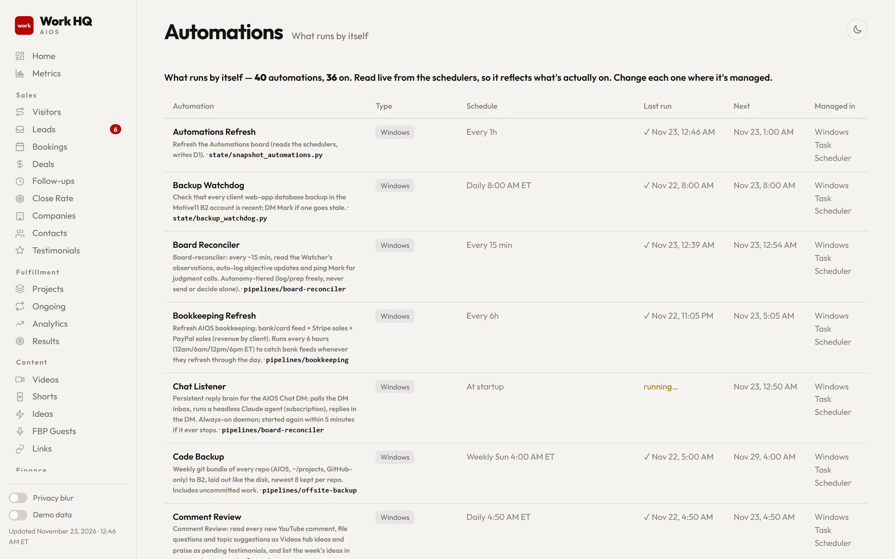

## The business

I run two companies by myself. Motive11 builds custom software and AI systems for businesses, and nine of those clients are on monthly plans. Szymanski Media is the content side: a YouTube channel, a podcast, two weekly newsletters, short videos every day on two brands, and a paid community for people who build things for clients.

That's the output of a small team. I don't have one.

## The problem

Before this, the business lived where most businesses live: in my head, my inbox, a dozen apps, and a task list that was never quite true. Every new client meant more to remember. Every new channel meant another login and another thing I did by hand.

The risk was simple. If something lived only in my head, it only got done when I remembered it. And the AI I was using every day started every conversation from zero, because nothing about the business was written down anywhere it could read.

## What I built

**The business, written down.** Who my clients are, what I sell and at what price, how I write, how each job runs from first call to invoice, and the rules I've decided to hold myself to. It's plain text in folders I own, and every AI I use reads it before it does anything.

**My data, in one place.** My bank and card feeds, Stripe, my calendar, my site traffic, my videos, and my email list all feed one database I own, instead of staying split across the apps that collect them.

**An HQ on top.** One app I run both businesses from: leads, deals, projects, clients on monthly plans, the books, video ideas, and site traffic. It replaced QuickBooks, Calendly, and Google Tasks along the way, because once the data was mine, building the screen I wanted was faster than bending someone else's.

**Automations, with me in charge of anything that leaves the building.** The books refresh every six hours. My short videos post themselves after I approve them. Every morning my task list tells me who to reach out to. Backups run every night. Anything that sends, posts, or spends money waits for my yes, usually a one-word reply in a chat message.

## What changed

**36 automations run every day, and 43 jobs the business does are written down as repeatable processes.** Eighteen of those start on their own; the rest start when I say the word. Every one of them shows up on one screen, so I can see what's running and whether it worked.

The same week a client signs, their work goes on the board, and nothing about them lives only in my head. The books are current every day instead of every quarter. When I sit down to work, the AI already knows the business, so I spend my time deciding, not re-explaining.

## What this means for you

It's the same system I build for clients, on the same stack, in your own accounts. Yours won't have my podcast or my community in it. It'll have your jobs, your customers, your numbers, and the way your people actually work. You own all of it.
